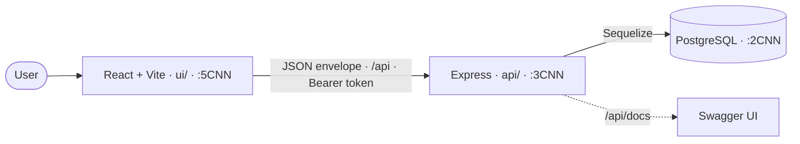

<!-- Generated by Lighthouse – Contract Kit v1.3.0 from lighthouse.config.json (86539ede). Regenerate instead of editing by hand. -->
> **Lighthouse 123** · ARCHITECTURE.md · generated 2026-11-23 · config `86539ede` · compatibility **WARN**

# Architecture: Lighthouse 123

Lighthouse 123 is a React + Vite UI and an Express API, written in JavaScript, storing data in PostgreSQL through Sequelize. Folder names, layers and the API contract are the shared standard of every A1/A2/A3 app (`contract-kit/docs/ARCHITECTURE.md`, `PROJECT_CONTRACT.md`); only file extensions and framework wiring change with the stack.

## 1. System overview


| | Host port | URL |
|---|---|---|
| API | 3CNN | http://localhost:3CNN/api (Swagger: /api/docs) |
| UI | 5CNN | http://localhost:5CNN |
| Database | 2CNN | container port of PostgreSQL |

Ports are not assigned yet: `C` = port group (1 A1 main app, 2 A2 API, 3 A3 application) and `NN` = project number, from `contract-kit/docs/PORTS.md`. Replace `3CNN`, `5CNN` and `2CNN` everywhere before scaffolding.

## 2. Repository layout
```
lighthouse-123/
├─ api/                        # Express (JavaScript)
├─ ui/                         # React + Vite (JavaScript)
├─ docs/                       # app-level docs (below)
├─ docker-compose.yml          # profiles: db, api, ui  (templates/docker-compose.template.yml)
├─ .env.docker                 # ports from docs/PORTS.md
├─ package.json                # delegating scripts only (templates/package-scripts.root.json)
├─ CHANGELOG.md
└─ README.md
```

## 3. Backend: Express + Sequelize (JavaScript)
### 3.1 Folders
```
api/
├─ src/
│  ├─ server.js                   # listen() only
│  ├─ app.js                      # createApp() (see express/src/app.example.js)
│  ├─ common/
│  │  ├─ config/env.js
│  │  ├─ contract/response.js     # sendSuccess, sendCreated, sendPaginated, sendError, AppError
│  │  ├─ middlewares/             # request-id, error-handler, validate, auth
│  │  └─ pagination/
│  ├─ helpers/index.js            # from the kit
│  ├─ database/
│  │  ├─ models/
│  │  ├─ migrations/
│  │  └─ seeders/
│  ├─ observability/              # observability.router.js (copied from the kit)
│  └─ modules/
│     └─ <feature>/
│        ├─ <feature>.routes.js
│        ├─ <feature>.controller.js
│        ├─ <feature>.service.js
│        └─ <feature>.schema.js   # Zod
├─ tests/
│  └─ <feature>.test.js           # node --test; mirrors modules/
├─ docs/
├─ .env.example
└─ package.json
```

### 3.2 Layers
- Same split as Nest: routes wire, controller parses and responds with `send*`, service returns raw data and throws `AppError`.
- Wrap async handlers with `asyncHandler`, validate with `validate(schema, 'body' | 'query' | 'params')`, read the parsed value from `req.valid`.
- `tests/` (plural), `middlewares/` (plural): the two spellings that were split across your repos.
- Not verified: pointing `sequelize-cli` at `src/database/*` needs a `.sequelizerc`, and in an ESM project the migration and seeder files normally have to be `.cjs`. Try it on the first new Express app before copying the pattern.

Both keep the controller / service split. Express modules export plain functions (`listProducts`, `createProduct`): classes in Express need `this` binding when passed to a route and add nothing. Nest uses classes because its DI is built on them.

### 3.3 Request lifecycle
1. `requestId` sets `req.requestId` and the `X-Request-Id` header (registered first).
2. `cors({ origin: CORS_ORIGIN })`, `express.json()`.
3. Routers under `/api`: the observability router, `/api/auth`, then one router per feature.
4. In a feature route: `auth` middleware -> `requireRoles(...)` (401 vs 403) -> `validate(schema, "body" | "query" | "params")` -> controller wrapped in `asyncHandler`.
5. The controller reads `req.valid`, calls the service and answers with `sendSuccess` / `sendCreated` / `sendPaginated`.
6. The service holds the logic, uses the Sequelize models, returns raw data and throws `AppError` (e.g. 404 `NOT_FOUND`).
7. `notFoundHandler` answers unknown routes with 404 `NOT_FOUND`; `errorHandler` (registered last) turns every error into the error envelope.

### 3.4 Stack notes
- Controllers return nothing but `send*` calls; services return raw data and throw `AppError`. *(Express)*
- Do not export `{ data }` from a service: the contract wraps it once. *(Express)*
- ESM project: migrations and seeders usually have to be `.cjs` [?]. *(Sequelize)*
- Seeds are not tracked by default: running `db:seed:all` twice inserts twice unless the seed is idempotent [V: default is `none`]. *(Sequelize)*
- Two apps on one host must use different `2CNN` ports. *(PostgreSQL)*
- `DATABASE_URL` in `.env` uses the host port; inside compose the API reaches the database by service name on 5432 [?]. *(PostgreSQL)*

## 4. Frontend: React + Vite + Tailwind CSS (JavaScript)

### 4.1 Folders
```
ui/
├─ public/
├─ src/
│  ├─ main.jsx
│  ├─ app/
│  │  ├─ App.jsx
│  │  ├─ router.jsx               # routes -> pages
│  │  └─ providers.jsx            # QueryClient, theme, toaster
│  ├─ pages/                      # one file per route; composes features, no data logic
│  ├─ features/
│  │  └─ <feature>/
│  │     ├─ api.js                # the only place that calls apiClient + unwrapItem/List/Page
│  │     ├─ hooks.js              # React Query hooks
│  │     ├─ components/
│  │     └─ index.js              # public surface of the feature
│  ├─ components/
│  │  ├─ ui/                      # primitives (Button, Input, Dialog)
│  │  ├─ layout/
│  │  └─ QueryState.jsx           # loading / error / empty (from the kit)
│  ├─ lib/
│  │  ├─ api-client.js            # from the kit
│  │  └─ error-messages.js        # from the kit
│  ├─ helpers/index.js            # formatIdr, formatDateTime, slugify (from the kit)
│  ├─ stores/                     # Zustand, only for client state
│  └─ styles/tokens.css           # from the kit, the only place with raw colors
├─ index.html                     # font <link> (see tokens.css)
├─ .env.example                   # VITE_API_URL
└─ package.json
```

### 4.2 Rules

- Page and route files compose; **features own data**. Components never call axios directly.
- Only `lib/api-client.js` touches the response envelope, through `unwrapItem` / `unwrapList` / `unwrapPage`.
- Components use semantic tokens only (`docs/DESIGN_SYSTEM.md`), never raw hex.
- Environment: `VITE_API_URL` / `NEXT_PUBLIC_API_URL` = `http://localhost:3CNN/api` (see `templates/env.example.frontend`).

### 4.3 Data flow

1. A page in `pages/` composes feature components; it holds no data logic.
2. A component calls a hook from `features/<feature>/hooks.js` (TanStack Query: caching, refetch, mutations).
3. The hook calls `features/<feature>/api.js`, the only place that uses `apiClient`.
4. `lib/api-client` (axios) adds `Authorization: Bearer <accessToken>`, calls `VITE_API_URL` (http://localhost:3CNN/api) and unwraps the envelope with `unwrapItem` / `unwrapList` / `unwrapPage`.
5. A failure becomes `ApiError` (`code`, `message`, `requestId`, `details`); `lib/error-messages` turns `error.code` into the message shown to the user.
6. `QueryState` renders loading, empty and error the same way on every screen.

### 4.4 Styling

Use Tailwind CSS v4 with `@tailwindcss/vite`. All colors come from the tokens in `src/styles/tokens.css`; never write raw hex in components.

Every app ships `src/styles/tokens.css` with the same four layers:

1. **Brand scale** `--color-brand-50 ... 900` (the only thing that changes per brand)
2. **Semantic tokens** `primary`, `secondary`, `accent`, `background`, `foreground`, `surface`, `muted`, `border`, `success`, `warning`, `destructive` (+ `-hover`, `-light`, `-foreground`)
3. **Typography** `--font-display` (Plus Jakarta Sans), `--font-body` (Inter), `--font-mono` (JetBrains Mono), optional `--font-serif` (Lora, for documents)
4. **Shape** radius and shadow

Rules:
- Components use semantic tokens only, never raw hex.
- Dark mode overrides semantic tokens under `:root[data-theme="dark"]`.
- A brand may swap `--font-display` when the concept needs it; keep the others.
- Document the brand's primary hex and the font choice in the app's own `docs/design-system.md`.

### 4.5 Stack notes

- Only variables that start with `VITE_` reach the browser. *(React + Vite)*
- The kit front end has not been opened in a browser; check `QueryState` and the toast mapping by hand on the first app. *(React + Vite)*
- `@theme` variable names create utilities (e.g. `--color-brand-600` -> `bg-brand-600`); renaming a token renames the utility [?]. *(Tailwind CSS)*
- The kit tokens were checked for contrast, not rendered. *(Tailwind CSS)*
- Refresh-token retry logic is not in the kit; write it in `api-client.ts` once, not per feature. *(Axios)*
- `QueryState` is typechecked but not rendered with real queries yet [?]. *(TanStack Query)*
- `stores/` names Zustand, which has no library document yet: leave the folder out until it is added. *(ARCHITECTURE.md)*

## 5. Naming
| Thing | Convention | Example |
|---|---|---|
| Folders, API files | kebab-case | `order-items/`, `order-items.service.js` |
| React components | PascalCase file | `OrderCard.jsx` |
| Hooks | `use` + camelCase | `useOrders` |
| Test files | API: `tests/<feature>.test.js` (`node --test`); UI: next to the code (`*.test.jsx`) | |
| Routes | plural kebab-case under `/api` | `/api/order-items` |
| DB tables | snake_case plural | `order_items` |

## 6. Same job, same place
| Job | Express |
|---|---|
| Entry | `src/server.js` + `src/app.js` |
| Response contract | `common/contract/response.js` + `middlewares/error-handler.js` |
| Request id | `common/middlewares/request-id.js` |
| Validation (Zod) | `common/middlewares/validate.js` |
| Pagination | `common/pagination/` |
| Env validation | `common/config/env.js` |
| Observability | `observability/` (`createObservabilityRouter`) |
| Feature | `modules/<feature>/` |
| Unit / integration tests | `tests/` |

## 7. `common/` vs `helpers/`
| | `common/` | `helpers/` |
|---|---|---|
| Holds | The API's contract plumbing: envelope, filters, interceptors, middleware, pipes, auth, config | Small pure functions: format, slug, mask |
| May import the framework | yes | no |
| May touch I/O or the request | yes | never |
| Business rules | no | no (they live in `modules/` or `features/`) |
| Index | one folder per concern | one `index` file, split into `helpers/<topic>.ts` when it grows |

Frontend: `lib/` is plumbing (api-client, error messages); `helpers/` is pure functions. A helper that needs `fetch` or React is not a helper.

## 8. Unverified
- `library/backend/express.md`: express-generator layout: from experience
- `library/orm/sequelize.md`: `init`, `db:create`, `db:migrate`, `db:seed:all`, `model:generate`: not on the fetched page
- `library/orm/sequelize.md`: `.cjs` for ESM: not verified
- `library/database/postgresql.md`: Current server major: not checked
- `library/database/postgresql.md`: Compose template runs: not run
- `library/frontend/react-vite.md`: Runs in a browser: not tried
- `library/css/tailwindcss.md`: tokens.css compiles in Tailwind: not compiled
- `library/combos/express-sequelize-postgresql.md`: ESM project: migrations/seeders as `.cjs`
- `library/combos/express-sequelize-postgresql.md`: `.sequelizerc` with ESM models
- `library/combos/express-sequelize-postgresql.md`: `db:create` before `db:migrate` in `db:setup`: not run
- `library/combos/express-sequelize-postgresql.md`: Compose template starts the database and the API: not run
- `library/database/postgresql.md` is a **draft**: treat every claim in it as unverified.
