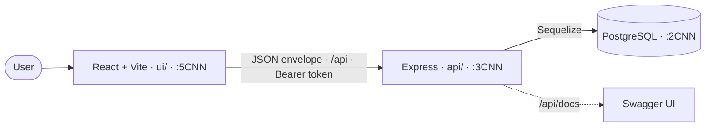
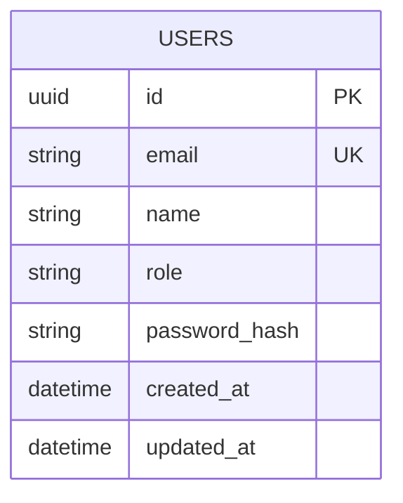

<!-- Generated by Lighthouse – Contract Kit v1.3.0 from lighthouse.config.json (86539ede). Regenerate instead of editing by hand. -->
> **Lighthouse 123** · SYSTEM_DESIGN.md · generated 2026-11-23 · config `86539ede` · compatibility **WARN**

# System Design: Lighthouse 123

A web-based CMS and backoffice for managing articles, media, and content.

## 1. System overview and data flow


| | Host port | URL |
|---|---|---|
| API | 3CNN | http://localhost:3CNN/api (Swagger: /api/docs) |
| UI | 5CNN | http://localhost:5CNN |
| Database | 2CNN | container port of PostgreSQL |

Ports are not assigned yet: `C` = port group (1 A1 main app, 2 A2 API, 3 A3 application) and `NN` = project number, from `contract-kit/docs/PORTS.md`. Replace `3CNN`, `5CNN` and `2CNN` everywhere before scaffolding.

## 2. Conceptual data model


The users entity follows the kit auth contract. Feature entities contain only the shared identity and timestamp fields. Business fields and relationships must be defined from the feature requirements before writing migrations; no foreign keys or relationships are assumed here. For document databases, these are conceptual entities rather than SQL tables.

- IDs: UUID. Timestamps: `createdAt`, `updatedAt` (optional `deletedAt` for soft delete).
- Times are stored and sent in UTC, ISO 8601 (`2026-11-22T14:00:00.000Z`).
- Money: a **whole-number integer in rupiah** plus `currency` (`"IDR"`): `price: 10000` is Rp 10.000. No decimals, no floats. Name fields plainly (`price`, `total`). If an app ever takes a foreign currency, the rule for it is written down at that time (not guessed now).
- JSON is camelCase; DB columns are snake_case (map in the ORM).

| Table | Columns | Source |
|---|---|---|
| `users` | `id` (UUID), `email` (unique), `name`, `role` (ADMIN, STAFF, USER), password hash, `created_at`, `updated_at` | auth contract (3.4) |
| `<resource>` | `id` (UUID), the fields of each feature (decided in its step, before coding), `created_at`, `updated_at` | feature each feature |

## 3. API design
Base URL: `http://localhost:3CNN/api` · Swagger UI: `http://localhost:3CNN/api/docs` · no version segment.

### 3.1 Response envelope
```json
{ "success": true, "message": "OK", "data": {}, "meta": null, "error": null, "requestId": "req_xxx" }
```
```json
{ "success": false, "message": "Validation failed", "data": null, "meta": null,
  "error": { "code": "VALIDATION_ERROR", "details": [] }, "requestId": "req_xxx" }
```
- `message` is in English. `error.code` is a machine-readable English constant.
- Lists: `data` is an array and `meta.pagination` = `{ page, limit, total, totalPages }`. Feeds may use `meta.cursor`.
- `requestId` is generated by middleware (or taken from `X-Request-Id`) and returned in the `X-Request-Id` header.

| Status | `error.code` |
|---|---|
| 400 | `VALIDATION_ERROR` (or `BAD_REQUEST`) |
| 401 | `UNAUTHORIZED` |
| 403 | `FORBIDDEN` |
| 404 | `NOT_FOUND` |
| 409 | `CONFLICT` |
| 422 | `UNPROCESSABLE` |
| 429 | `RATE_LIMITED` |
| 500 | `INTERNAL_ERROR` |

Domain codes (e.g. `SLOT_TAKEN`) are allowed; keep them UPPER_SNAKE_CASE.

### 3.2 Endpoints
| Group | Method | Path | Access | Notes |
|---|---|---|---|---|
| Observability | GET | `/api/health` | Open | status, application, database, version, timestamp, uptime |
| Observability | GET | `/api/version` | Open | name, type, version, commit |
| Observability | GET | `/api/public` | Open | name, environment, docsUrl, serverTime |
| Observability | GET | `/api/monitoring` | ADMIN, STAFF | node, memory, database latency |
| Observability | GET | `/api/activities` | ADMIN, STAFF | latest 30 activities |
| Auth | POST | `/api/auth/login` | Open | body `{ email, password }` |
| Auth | POST | `/api/auth/refresh` | Open | body `{ refreshToken }` |
| Auth | GET | `/api/auth/me` | Any signed-in role | `{ id, email, name, role }` |
| <Feature> | GET | `/api/<resource>` | ADMIN, STAFF, USER | list; `meta.pagination` |
| <Feature> | GET | `/api/<resource>/:id` | ADMIN, STAFF, USER | one item; 404 `NOT_FOUND` |
| <Feature> | POST | `/api/<resource>` | ADMIN, STAFF | 201; the created item |
| <Feature> | PATCH | `/api/<resource>/:id` | ADMIN, STAFF | the updated item |
| <Feature> | DELETE | `/api/<resource>/:id` | ADMIN, STAFF | `data: null`; 404 if missing |

- Every endpoint answers in the envelope of 3.1 and is documented in Swagger.
- Feature endpoints are the standard set; drop the ones a feature does not need. Update uses `PATCH` and access defaults to read: ADMIN, STAFF, USER / write: ADMIN, STAFF (generator defaults, set per feature in the config).
- `/api/public/<resource>` (open dashboard data) is written per app: allow-list DTO, no email or phone, names masked with `maskName` (FR-007).

### 3.3 Query parameters (every list)
`?page=1&limit=20&sort=-createdAt&q=term`
- `page` >= 1 (default 1), `limit` 1-100 (default 20), `sort` = field with optional `-` prefix (default `-createdAt`; whitelist fields per endpoint), `q` = free text (max 100 chars).

### 3.4 Authentication
- `POST /api/auth/login` body `{ email, password }` -> `data: { accessToken, refreshToken, expiresIn, user }`.
- `POST /api/auth/refresh` body `{ refreshToken }` -> new `accessToken`.
- `GET /api/auth/me` -> `data: { id, email, name, role }`.
- Header: `Authorization: Bearer <accessToken>`.
- Access token payload: `{ sub: <user uuid>, role, iat, exp }`. Access 15 min, refresh 7 days.
- Roles: `ADMIN`, `STAFF`, `USER`.
- **401 `UNAUTHORIZED`**: missing, invalid or expired token.
- **403 `FORBIDDEN`**: authenticated, but the role is not allowed.
- Passwords: `bcryptjs`.

### 3.5 Observability responses
```jsonc
// GET /api/health  (HTTP 200 even when DOWN, same as the Bootcamp version)
{ "status": "UP" | "DOWN", "application": "Lighthouse 123", "database": "CONNECTED" | "DISCONNECTED",
  "version": "1.0.0", "timestamp": "ISO", "uptime": 123 }

// GET /api/monitoring
{ "application": "...", "node": { "version", "uptime", "platform", "environment" },
  "memory": { "rss", "heapTotal", "heapUsed", "external" },
  "database": { "status", "latency" }, "response": { "generatedAt" } }

// GET /api/activities  (max 30 entries, newest first, 5 per source)
[ { "id": "order-12", "type": "ORDER_CREATED", "entity": "Order", "title": "#12",
    "description": "Order PENDING", "createdAt": "ISO", "application": "Lighthouse 123" } ]
```

All of these are wrapped in the standard envelope (`CONVENTIONS.md`).

## 4. Modules and dependencies
| Module | Responsibility | Dependencies |
|---|---|---|
| Auth | Login, refresh tokens, current user and roles | Users, auth middleware |
| Observability | Health, version, public information, monitoring and activities | Database probe, role checks, activity sources |

### Request lifecycle
1. `requestId` sets `req.requestId` and the `X-Request-Id` header (registered first).
2. `cors({ origin: CORS_ORIGIN })`, `express.json()`.
3. Routers under `/api`: the observability router, `/api/auth`, then one router per feature.
4. In a feature route: `auth` middleware -> `requireRoles(...)` (401 vs 403) -> `validate(schema, "body" | "query" | "params")` -> controller wrapped in `asyncHandler`.
5. The controller reads `req.valid`, calls the service and answers with `sendSuccess` / `sendCreated` / `sendPaginated`.
6. The service holds the logic, uses the Sequelize models, returns raw data and throws `AppError` (e.g. 404 `NOT_FOUND`).
7. `notFoundHandler` answers unknown routes with 404 `NOT_FOUND`; `errorHandler` (registered last) turns every error into the error envelope.

## 5. Compatibility and unverified decisions
**Level: WARN**: Works in principle but needs a conversion or has an open point.

- [warn] The kit front end files are .ts/.tsx. Convert them or choose TypeScript.
- [warn] The stack differs from preset "Express + Sequelize + React (Vite)". Set `preset` to "custom" or restore the preset stack.

Kit combo document: `library/combos/express-sequelize-postgresql.md`.

- `library/languages/javascript.md`: `.cjs` migrations needed with sequelize-cli: From experience; try it on the first Express app
- `library/frontend/react-vite.md`: Runs in a browser: not tried
- `library/css/tailwindcss.md`: tokens.css compiles in Tailwind: not compiled
- `library/backend/express.md`: express-generator layout: from experience
- `library/orm/sequelize.md`: `init`, `db:create`, `db:migrate`, `db:seed:all`, `model:generate`: not on the fetched page
- `library/orm/sequelize.md`: `.cjs` for ESM: not verified
- `library/database/postgresql.md`: Current server major: not checked
- `library/database/postgresql.md`: Compose template runs: not run
- `library/tooling/eslint.md`: Init command: not fetched
- `library/integrations/bcryptjs.md`: Usage in the kit: none
- `library/integrations/jsonwebtoken.md`: Login / refresh implementation: not in the kit
- `library/integrations/axios.md`: Runs against a real API: not run
- `library/integrations/tanstack-query.md`: Use in the kit: only referenced in ARCHITECTURE.md
- `library/combos/express-sequelize-postgresql.md`: ESM project: migrations/seeders as `.cjs`
- `library/combos/express-sequelize-postgresql.md`: `.sequelizerc` with ESM models
- `library/combos/express-sequelize-postgresql.md`: `db:create` before `db:migrate` in `db:setup`: not run
- `library/combos/express-sequelize-postgresql.md`: Compose template starts the database and the API: not run
- `library/database/postgresql.md` is a **draft**: treat every claim in it as unverified.
- `library/integrations/tanstack-query.md` is a **draft**: treat every claim in it as unverified.
